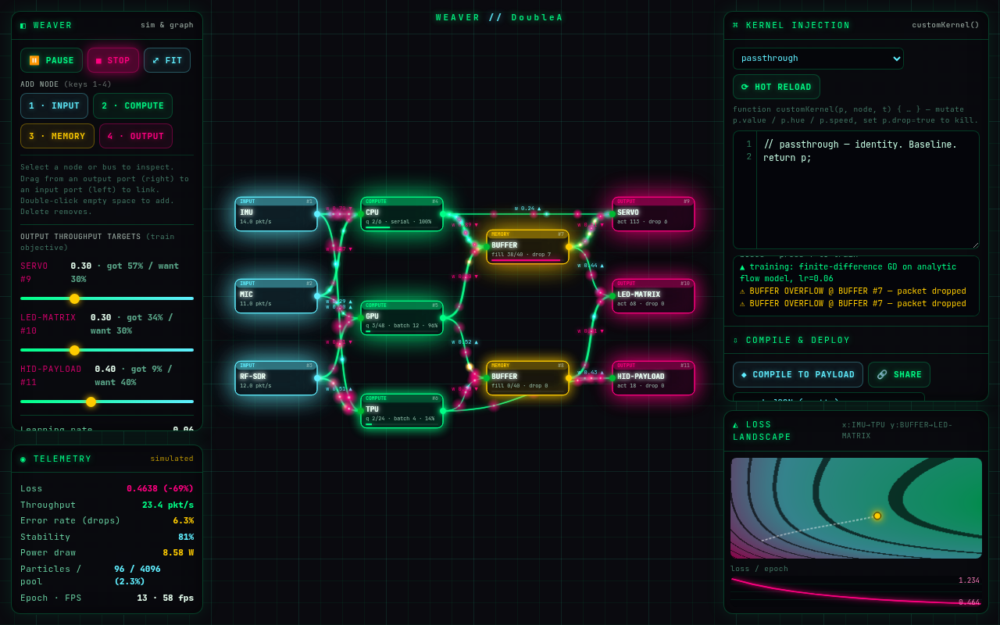

# NEXUS Weaver

**A live hardware ⇄ software dataflow weaver.** Wire sensors into CPU/GPU/TPU lanes, memory buffers and actuators; watch real packets flow; inject your own kernel while it runs; then hit **TRAIN** and watch gradient descent rewire the bus weights to hit your throughput targets.

One HTML file. No build step. Vanilla JS + Canvas 2D.

**Live demo:** https://antmanthepro.github.io/nexus-weaver/  *(placeholder: goes live once Pages is enabled)*



> Everything on screen is simulated. Throughput, power and error numbers come from the in-browser simulation, not from real hardware.

---

## What it does

| Layer | What's actually happening |
|---|---|
| **Node graph** | `INPUT` (IMU · MIC · RF-SDR) → `COMPUTE` (CPU · GPU · TPU) → `MEMORY` (state buffer) → `OUTPUT` (SERVO · LED-MATRIX · HID-PAYLOAD). Buses carry **weight**, **latency** and **bandwidth**. Bezier thickness shows the weight. |
| **Particle dataflow** | Inputs spawn packets at fixed rates. Packets move along buses with latency-aware interpolation, queue at nodes, get processed and routed onward. Routing is weighted-random by bus weight, and each bus has a token-bucket bandwidth cap. Everything runs on a **preallocated 4096-slot object pool**, so the hot loop never allocates. |
| **Compute personalities** | **CPU:** serial. One packet in service at a time (μ=22/s), 6-slot queue, low latency. **GPU:** gathers packets for 0.35 s, then flushes up to 12 in one parallel burst. Big queue, high latency, 3.4 W. **TPU:** 4-wide tiles that run a real 4×4 mat-mul on packet values. The matrix comes from the TPU's own outgoing bus weights. 1.5 W. |
| **Memory** | FIFO buffer with a visible fill bar (cap 40). When it overflows, packets drop and count as errors, and the screen flashes and shakes. |
| **Kernel injection** | You write the body of `customKernel(p, node, t)`. It runs on every packet at every processing node. |
| **Training** | Real gradient descent on bus weights against a defined objective (details below). |
| **Compile & deploy** | Exports graph JSON, a standalone runtime and a pure step function. **SHARE** puts the whole graph in the URL. |

## Controls

| Input | Action |
|---|---|
| Drag empty canvas / middle or right mouse | Pan |
| Wheel / trackpad pinch | Zoom around cursor |
| Two-finger drag / pinch (touch) | Pan / zoom |
| Drag node | Move |
| Drag from a node's **right port** to another node | Create bus |
| Click node / bus | Select + inspect (edit sub-type, weight, latency, bandwidth) |
| `Delete` / `Backspace` | Remove selection |
| Double-click / double-tap empty space | Add-node palette |
| `1` `2` `3` `4` | Add INPUT / COMPUTE / MEMORY / OUTPUT |
| `Space` | Pause / resume sim |
| `T` | Train on/off |
| `F` | Fit view |
| `Ctrl/Cmd + Enter` | Hot-reload kernel |
| `Esc` | Deselect |

On phones (≤760 px) the panels collapse into a bottom sheet driven by a tab bar (CANVAS · BUILD · KERNEL · STATS · LOSS). The canvas stays fully interactive, and a floating TRAIN button stays in reach.

## Kernel injection

```js
// body of: function customKernel(p, node, t)
// p: { value, hue, speed, drop, prio }   node: { id, type, sub, ... }   t: sim seconds
p.value = Math.max(0, p.value);
if (p.value > 5) p.value = 5;
p.hue = 150 - p.value * 12;
return p;
```

- **Compile:** a guarded `new Function` inside `try/catch`, plus a smoke test on a throwaway packet. If compilation fails, the error shows in the console strip and the previous kernel keeps running.
- **Runtime:** every call is wrapped in `try/catch`. Non-finite `value`/`speed` values get sanitized. After **12 faults** the kernel is auto-disabled and the sim reverts to the **last-known-good** kernel. A new kernel only becomes last-known-good after 240 clean invocations.
- **Presets:** `passthrough`, `ReLU clamp`, `jitter / fuzz (QA stress)` (perturbs values and injects 3% random faults), and `priority boost · HID payload` (tags strong packets `prio=1`, and the router biases those ×4 toward buses that feed HID-PAYLOAD).
- A kernel runs with page privileges. This is a local sandbox toy, not a security boundary. Don't paste code you don't trust.

## Training: what's real and what's approximated

**Objective:**

```
loss = 4.0 · Σ_k (share_k − target_k)²     // match the target split across OUTPUT nodes
     + 1.5 · drops / spawned                 // penalize packet loss
     + 0.25 · power / maxPower               // penalize energy use
```

The per-output targets are sliders in the BUILD panel.

**Model:** the loss is computed on an **analytic steady-state flow model** of the graph, not on noisy live counters. Each service node soft-caps throughput at its rate μ with `out = f / (1 + (f/μ)⁴)^¼`. Each bus splits its source node's output by weight share and soft-caps at bandwidth. The excess becomes drops. Jacobi iteration handles arbitrary topologies, including cycles.

**Gradients:** these are **central finite differences** (`h = 1e-3`) over every bus weight, not autodiff. Each epoch takes one plain GD step, clamps weights to [0.03, 1], and stops automatically on a plateau.

**Visuals:** pink pulses travel backward along each bus, scaled by |∂L/∂w|, and ▲/▼ labels show the weight updates. The loss-landscape inset is a true 2-D slice: the model loss is evaluated on a 30×30 grid over the two weights with the largest gradient, with the descent ball and its trail drawn on top.

**Honest caveat:** the flow model approximates the particle sim. It doesn't capture GPU burst latency or queueing jitter. After training, the live measured output split moves toward the targets, but it won't match them exactly.

Measured in headless Chrome on the default scene, lr=0.06: model loss went from **1.474 to 0.331 in 42 epochs** (−77.5%), and loss was non-increasing on every epoch.

## Compile & deploy

- **Graph JSON:** nodes, links (weight/latency/bandwidth), targets, kernel source and node specs.
- **Standalone JS:** `createNexusGraph(canvas, GRAPH, {autoplay})` returns `{ step, draw, stop, stats }`. It's minified, has no dependencies and can be dropped into React:
  ```js
  useEffect(() => { const g = createNexusGraph(ref.current, GRAPH); return g.stop; }, []);
  ```
- **Pure `step(state, dt)`:** a fluid-level simulation step. It returns a *new* state (`levels`, `time`, `lastStats`) and never mutates its input or touches the DOM.
- **SHARE:** encodes the graph as `#z.<base64url(deflate-raw(JSON))>` using `CompressionStream`, or `#j.<base64url(JSON)>` as a fallback. The link is decoded on load.

## Architecture (single file, sectioned)

```
0  constants & palette           7  loss landscape + sparkline
1  neon multi-pass glow utils    8  renderer (grid, buses, sprites, nodes)
2  particle object pool          9  viewport + pointer/touch/keyboard
3  graph model + default scene  10  URL-hash codec
4  guarded kernel injection     11  payload emitters
5  particle simulation          12  UI wiring, HUD, mobile sheet, boot, main loop
6  flow model + FD training
```

- A fixed-step sim at 120 Hz with an accumulator, decoupled from rendering and capped at 8 sub-steps per frame.
- Particle glow comes from pre-rendered radial sprites (12 hue buckets) drawn additively. Buses and nodes use real multi-pass `shadowBlur`.
- The HUD writes to the DOM at about 6 Hz, and the landscape re-renders at about 11 Hz, only while visible.
- Critical layout CSS is inlined, so the app still lays out and runs if the Tailwind CDN or Google Fonts is unreachable.

## Tech

Vanilla JS · Canvas 2D · Tailwind Play CDN · JetBrains Mono. No frameworks, no bundler.

## Run locally

Open `index.html` directly, or serve it with `python3 -m http.server`. The clipboard API needs a secure context. On `file://`, copy falls back to selecting the text.

## License

MIT © 2026 DoubleA / AntManThePro
